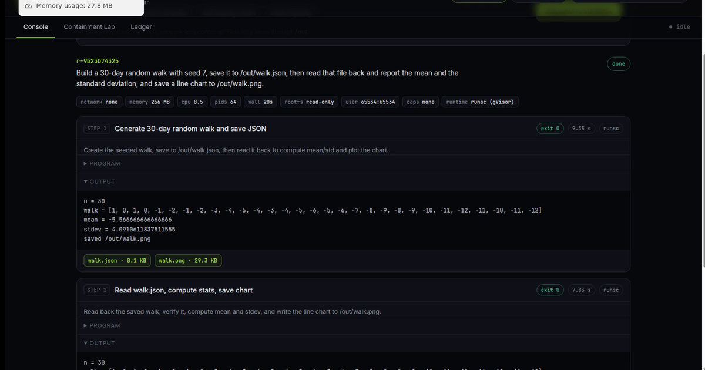
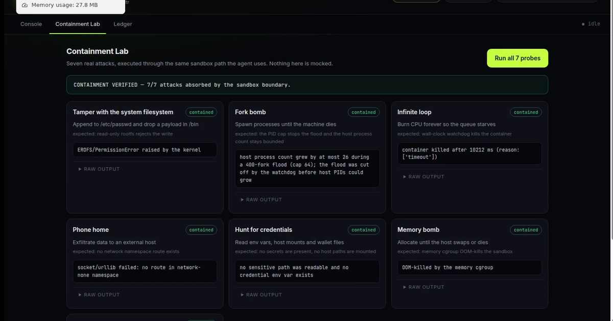
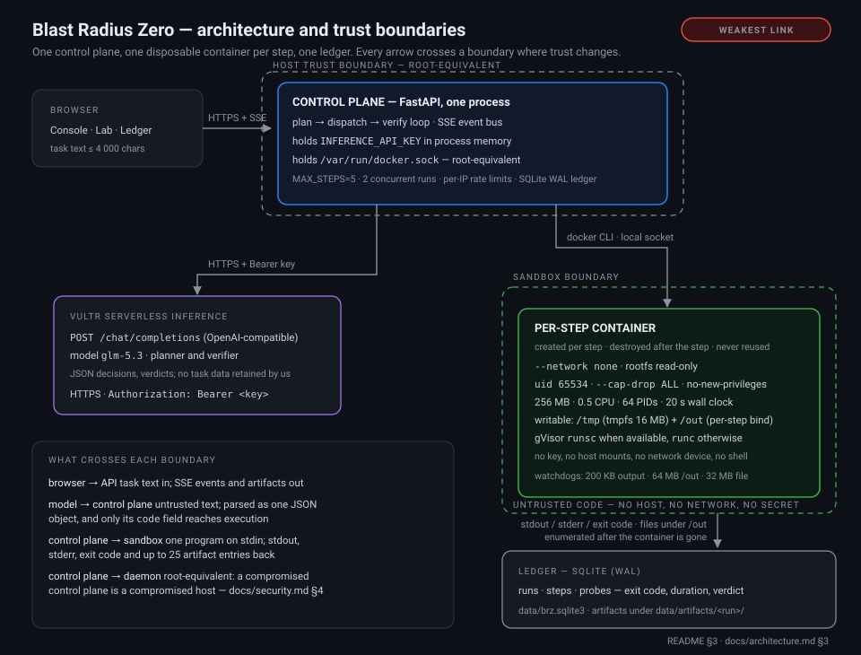

# Blast Radius Zero

**A containment-first agent runtime: every answer ships with the sandbox output that proves it, and every containment claim is re-tested against the kernel — on the same code path the agent uses.**

Submission for lablab.ai × Vultr **Agent Rush Hackathon — Challenge 1: Blast Radius Zero**.

[](https://github.com/coldall1304/blast-radius-zero/actions/workflows/ci.yml) — every push re-runs the unit suite, the integration suite and the seven-probe containment gate, and the build fails if any probe escapes.

| | |
|---|---|
| **Live demo** | https://158.247.240.81.sslip.io |
| **Demo video** (116 s) | https://158.247.240.81.sslip.io/static/brz-demo.mp4 · also `app/static/brz-demo.mp4` |
| **Pitch deck** (8 slides) | `docs/slides.pdf` (source: `docs/slides.html`) |
| **Architecture** | `docs/architecture.md` · **Security model** `docs/security.md` |
| **Submission package** | `docs/submission.md` (field values, verified evidence) |

## Built on Vultr

Everything the live demo runs on is Vultr: one Cloud Compute instance and one model API.

| | |
|---|---|
| **Compute** | `vc2-1c-1gb` in the Seoul region, provisioned by [`deploy/vultr_provision.py`](deploy/vultr_provision.py) and deployed by [`deploy/install.sh`](deploy/install.sh). The control plane, the Docker daemon and every per-step sandbox container share that one instance. |
| **Inference** | the planner and the verifier both call **Vultr Serverless Inference** (`glm-5.3`) over the OpenAI-compatible `POST /chat/completions`. No other model provider is used. |
| **Isolation** | sandbox steps run under gVisor (`runsc`) on that instance, so model-written Python meets a user-space kernel rather than the host's. `SANDBOX_RUNTIME=auto` falls back to `runc` where gVisor is not installed, and `/api/config` reports which one is live. |

The project is an entry in the lablab.ai × Vultr **Agent Rush** hackathon. This section is the
attribution Vultr's [Open Source Credits](https://discover.vultr.com/open-source-credits) program
asks for: [**vultr.com**](https://www.vultr.com/). It is text and link only — no Vultr logo asset is
bundled, because no official, re-distributable image file could be verified from Vultr's brand page
at the time of writing.


*Console — the program the planner wrote, the bytes the sandbox produced, and the verifier's verdict, side by side.*


*Containment Lab — seven live attacks through the same sandbox path; each card carries the kernel's own evidence line.*

---

## 1. What it is

Blast Radius Zero is a web application that takes a natural-language task, plans it, runs the
resulting Python inside a throwaway container on a Vultr VM, and returns an answer that has been
audited against the bytes the sandbox actually produced.

It is three things in one service:

| Layer | What it does | Where it lives |
|---|---|---|
| **Control plane** | FastAPI app on a Vultr VM. Owns the API key, the run loop, the SSE stream, the ledger. | `app/main.py`, `app/agent.py` |
| **Sandbox** | One fresh container per step, no network, read-only rootfs, no capabilities, hard CPU / RAM / PID / wall-clock / disk caps. Destroyed immediately after the step. | `app/sandbox.py` |
| **Containment Lab** | 7 real attacks executed through the *same* sandbox entry point, judged by their own output, written to the ledger as `contained` / `BREACHED`. | `app/redteam.py` |

The model never gets a host shell, a credential, a network device, or a reusable environment.
It gets one function: submit a program, receive stdout / stderr / exit code / artifacts.

## 2. Why this is a product and not a demo

An agent that only prints code is a demo. An agent that executes code is a liability unless the
box around it is measurable. Four properties make this a product:

1. **Evidence is the product surface.** The planner must finish with claims, and a separate
   verifier call audits those claims against recorded `stdout` / `stderr` / artifact names. A run
   that cannot be supported is returned as `unverified`, with the auditor's reason appended to the
   answer — not silently upgraded to confident prose. See `VERIFIER_SYSTEM` and `_verify()` in
   `app/agent.py`.
2. **The containment claim is executable.** `POST /api/containment/runs` fires seven adversarial
   programs (read-only rootfs, fork bomb, CPU runaway, egress, credential hunt, memory bomb, disk
   fill) and shows the kernel's answer. Nothing in the Lab is a mock; a probe that is not stopped
   reports `BREACHED` on the dashboard instead of being hidden.
3. **Budgets are bounded by construction.** A step cannot outlive its wall clock, memory, PID,
   file-size, artifact-byte or captured-output budget, and cannot be resumed afterwards: the
   container is created per step and removed once the step is over (see P2-8 for the one path
   where a subprocess timeout can skip removal).
4. **The ledger is the audit trail.** Runs, probes and their verdicts land in SQLite, so "it was
   contained" is a row with an exit code and a duration, not a sentence in a README.

## 3. Architecture



*The ASCII figure below, drawn: the two dashed bounds are the trust boundaries, and the control plane
is labelled the weakest link because it holds both `INFERENCE_API_KEY` and `/var/run/docker.sock`.
Source: [`docs/architecture-diagram.svg`](docs/architecture-diagram.svg).*

```
          browser
      ┌──────────────┐
      │ Console      │
      │ Lab · Ledger │
      └──────┬───────┘
             │ HTTPS + SSE
             ▼
╔══════════════════════════════════════════════════════════════════════╗
║ CONTROL PLANE — FastAPI on the Vultr VM                              ║
║ holds INFERENCE_API_KEY in process memory                            ║
║ plan → dispatch → verify loop · SSE event bus                        ║
║ MAX_STEPS=5 · 2 concurrent runs · per-IP limits                      ║
╚══════════════════════════════════════════════════════════════════════╝
      │                                                        │
      ▼ HTTPS + Bearer key                               ▼ docker CLI · local socket
┌─────────────────────────────────┐   ╔══════════════════════════════════════╗
│ Vultr Serverless Inference      │   ║ SANDBOX — fresh container per step   ║
│ /chat/completions (OpenAI)      │   ║ --network none · rootfs read-only    ║
│ model: glm-5.3                  │   ║ uid 65534 · cap-drop ALL             ║
└─────────────────────────────────┘   ║ 256 MB · 0.5 CPU · 64 PIDs · 20 s    ║
                                      ║ /tmp + /out writable only            ║
                                      ║ gVisor runsc when available          ║
                                      ╚══════════════════════════════════════╝
                                                         │ stdout / stderr / exit code
                                                         │ files under /out
                                                         ▼
                                         ┌───────────────────────────────┐
                                         │ LEDGER — SQLite               │
                                         │ runs · steps · probes         │
                                         │ exit · duration · verdict     │
                                         └───────────────────────────────┘
```

Trust boundaries, in order of importance:

- **Model → control plane.** Model output is untrusted input. It is parsed as one JSON object,
  and the only field that reaches execution is `code`, which is treated as data.
- **Control plane → sandbox.** One-way by design: code in, output and files out. No secret is
  passed across (`INFERENCE_API_KEY` stays in the host process; the container gets `HOME`,
  `PYTHONUNBUFFERED`, `PYTHONDONTWRITEBYTECODE`, `MPLCONFIGDIR`, `OPENBLAS_NUM_THREADS`,
  `OMP_NUM_THREADS` and nothing else).
- **Control plane → Docker daemon.** *This is the real trust boundary of the whole system.* The
  control plane speaks to `/var/run/docker.sock`, which is root-equivalent. See
  [`docs/security.md`](docs/security.md) §4.

## 4. Quick start

### Run the whole stack locally — one command

`make demo` brings up the same three pieces — control plane, Docker-daemon-driven sandbox, SQLite
ledger — on one machine, with `MOCK_INFERENCE=1`, so it needs no API key and no cloud account:

```bash
git clone <your-repo-url> brz && cd brz
make demo          # compose up: brz-sandbox:1 + control plane, then wait for /api/health
open http://127.0.0.1:8000
make verify        # image -> unit tests -> integration tests -> the 7-probe Lab
make down
```

| Target | What it does |
|---|---|
| `make demo` | builds `brz-sandbox:1` if missing, starts the stack, prints `/api/config` |
| `make verify` | the "verify it yourself" chain: sandbox image, unit tests, integration tests, containment lab |
| `make lab` | the seven probes, in-process, against the local Docker daemon |
| `make test` / `make test-all` | unit tests only / the full pytest suite, integration included |
| `make clean` | stack down, ledger and artifacts removed |

Requires Docker with the Compose v2 plugin, nothing else. This path is a local-dev convenience, not
the deployment: [`docker-compose.yml`](docker-compose.yml) mounts the Docker socket into the control
plane, which is root-equivalent on the host — the boundary in
[`docs/security.md`](docs/security.md) §4, and the reason that mount carries a warning comment.

Without Compose, run the app straight from a venv:

```bash
python3 -m venv .venv && . .venv/bin/activate && pip install -r requirements.txt
./deploy/build-sandbox.sh            # builds + smoke-tests brz-sandbox:1
MOCK_INFERENCE=1 uvicorn app.main:app --port 8000
```

### Step 1 — install on a Vultr VM (one command)

Ubuntu 24.04 x64, 2 vCPU / 4 GB minimum. `deploy/install.sh` is idempotent: it installs Docker,
Python venv, Caddy and gVisor, copies the app to `/opt/brz`, writes the systemd unit, and builds
the sandbox image. It writes no secrets. `sslip.io` resolves to the instance IP, so no DNS is
needed for a certificate:

```bash
sudo apt-get update && sudo apt-get install -y git
git clone <your-repo-url> brz && cd brz
sudo BRZ_DOMAIN="$(curl -s https://api.ipify.org).sslip.io" ./deploy/install.sh
```

The app binds `127.0.0.1:8000` only; Caddy publishes 80/443. Open 22 (your IP), 80 and 443 in the
Vultr firewall, never 8000. Full host notes: [`deploy/README.md`](deploy/README.md).

### Step 2 — configure the key

```bash
sudoedit /opt/brz/.env               # local dev: export the same names in your shell
```

Set `INFERENCE_API_KEY=` to your Vultr Serverless Inference key and `MOCK_INFERENCE=0`.
The shipped default is `MOCK_INFERENCE=1`, so a fresh box cannot burn tokens. Every variable is
documented in [`.env.example`](.env.example); the code reads them in `app/config.py`.

### Step 3 — verify

```bash
sudo systemctl restart brz            # local dev: uvicorn app.main:app --port 8000
curl -s http://127.0.0.1:8000/api/health
curl -s http://127.0.0.1:8000/api/config | jq '{runtime, gvisor, image_present, limits}'
```

Open the site → **Console** to dispatch a task, **Containment Lab** to run the seven probes,
**Ledger** to read the audit trail. `runtime: "runsc", gvisor: true` means gVisor is actually in
use; `runc` means the fallback path is active and the containment story is weaker.

Without a key the service still boots, `/api/health` and `/api/config` work, and `MOCK_INFERENCE=1`
exercises the sandbox with a deterministic two-step plan (UI and ledger mark those runs `mock`). The
mock does not implement the verifier protocol, so mock runs always end `unverified` — expected, not
a loop bug.

## 5. Configuration

All knobs live in `app/config.py` and are read once at import time.

| Env var | Default | Meaning |
|---|---|---|
| `INFERENCE_BASE_URL` | `https://api.vultrinference.com/v1` | OpenAI-compatible endpoint |
| `INFERENCE_API_KEY` | *(empty)* | Bearer key; host process only, never injected into the sandbox |
| `INFERENCE_MODEL` | `glm-5.3` | Chat model |
| `INFERENCE_TIMEOUT_S` | `90` | Per-request HTTP timeout |
| `MOCK_INFERENCE` | `0` | Deterministic stand-in for offline demos/tests |
| `SANDBOX_IMAGE` | `brz-sandbox:1` | Image tag, must exist locally |
| `SANDBOX_RUNTIME` | `auto` | `auto` \| `runsc` \| `runc`; `runsc` fails loudly if not installed |
| `SANDBOX_MEMORY_MB` | `256` | Memory cap; `--memory-swap` is set to the same value (no swap) |
| `SANDBOX_CPUS` | `0.5` | CPU quota |
| `SANDBOX_PIDS` | `64` | PID cgroup cap |
| `SANDBOX_TMP_MB` | `16` | `/tmp` tmpfs size (`noexec,nosuid,nodev`) |
| `SANDBOX_DISK_MB` | `64` | Watchdog ceiling on `/out` bytes |
| `SANDBOX_TIMEOUT_S` | `20` | Wall-clock watchdog |
| `SANDBOX_OUTPUT_BYTES` | `200000` | Captured stdout+stderr cap before the container is killed |
| `SANDBOX_NETWORK` | `none` | `none` \| `bridge` (only `none` is safe; changing it voids the Lab) |
| `MAX_STEPS` | `5` | Planner turns per run |
| `MAX_VERIFY_RETRIES` | `1` | Extra finish attempts after a verifier rejection |
| `MAX_TASK_CHARS` | `4000` | Declared limit (the API model currently hard-codes 4000) |
| `RUNS_PER_HOUR` | `12` | Per-IP task dispatch limit |
| `PROBES_PER_HOUR` | `20` | Per-IP probe suite limit |
| `MAX_CONCURRENT_RUNS` | `2` | Task semaphore; probes are additionally serialized to 1 |
| `DATA_DIR` | `./data` | SQLite DB + artifacts root |

## 6. Security model — mapped to the four containment focus areas

| Focus area | Implemented control | Code | Live evidence |
|---|---|---|---|
| **Process isolation** — execution never touches the host or app runtime | Fresh container per step; `--network none`; `--read-only` rootfs; only `/tmp` (tmpfs) and `/out` (per-step bind) writable; `--user 65534:65534`; `--cap-drop ALL`; `no-new-privileges`; `--init`; gVisor `runsc` when installed | `sandbox.execute()`, `app/sandbox.py:143` | `rootfs_write` → `EROFS`; `egress` → no route; `fork_bomb` → `BlockingIOError` |
| **Secret hygiene** — no API keys inside the sandbox | No `-e` for the key, no host mounts except `/out`, no `.env` in the image; only six non-secret env vars injected | `app/sandbox.py:161` | `secret_read` → env dump contains only image/build vars |
| **Resource limits** — time and memory caps on every run | 256 MB `--memory` + equal `--memory-swap`, `--cpus 0.5`, `--pids-limit 64`, `--ulimit fsize=32MB`, `--ulimit nofile=256`, 20 s watchdog, 64 MB `/out` watchdog, 200 KB output cap | `app/sandbox.py:146-157`, watchdog `:217` | `memory_bomb` → OOM-killed; `cpu_runaway` → killed at ~10.2 s (10 s probe budget); `disk_fill` → `OSError: File too large` at 32 MB |
| **Lifecycle discipline** — reset or destroy after each task | Container is never reused (`--rm=false` is deliberate: it keeps the container inspectable long enough to read `OOMKilled`), then `docker rm -f` runs after the watchdog loop | `app/sandbox.py:239-240` | After a full probe suite, `docker ps -a --filter name=brz-` returns 0 containers |

Deeper treatment — threat model, prompt injection, residual risk, and the Docker-socket trust
boundary — is in [`docs/security.md`](docs/security.md).

## 7. API

| Method | Path | Body / params | Returns |
|---|---|---|---|
| `GET` | `/api/health` | — | `{ok, image, image_present}` |
| `GET` | `/api/config` | — | `{model, mock, limits, runtime, gvisor, runtime_error, image_present, max_steps, stats}` |
| `POST` | `/api/runs` | `{"task": "..."}` (3–4000 chars) | `{run_id}`; `429` on rate limit |
| `POST` | `/api/containment/runs` | — | `{run_id}` for a 7-probe suite |
| `GET` | `/api/runs` | `?limit=` 1–100 (default 25) | run summaries, newest first |
| `GET` | `/api/runs/{id}` | — | run row + `steps[]` + `probes[]` |
| `GET` | `/api/runs/{id}/events` | — | `text/event-stream`: replay of the run so far, then live events, `: keep-alive` every 15 s, stream closes after `run.finished` |
| `GET` | `/api/runs/{id}/artifacts/{name}` | path | file from that run's `/out`; `400` on traversal, `404` if absent |
| `GET` | `/` , `/static/*` | — | UI |

SSE event types: `run.started`, `run.status` (`running` / `planning` / `verifying` / `exhausted`),
`step.started`, `step.log` (live stdout/stderr lines), `step.finished`, `verify`, `run.error`,
`run.finished`, and for the Lab `probe.suite.started`, `probe.started`, `probe.finished`,
`probe.suite.finished`.

```bash
RID=$(curl -s -X POST localhost:8000/api/runs \
  -H 'content-type: application/json' \
  -d '{"task":"Generate 500 rows of synthetic sales data, compute monthly revenue and write a summary CSV to /out."}' \
  | python3 -c 'import sys,json;print(json.load(sys.stdin)["run_id"])')
curl -N localhost:8000/api/runs/$RID/events
```

The API has **no authentication**; it is a public demo endpoint protected only by per-IP rate
limits. Do not put real credentials behind it.

## 8. Repository layout

```
blast-radius-zero/
├── app/
│   ├── main.py          FastAPI app, SSE bus, rate limit, routes, worker spawn
│   ├── agent.py         plan → dispatch → verify loop, planner/verifier prompts
│   ├── sandbox.py       docker run argv, watchdogs, artifact enumeration
│   ├── inference.py     Vultr Serverless Inference client, JSON extraction, mock
│   ├── redteam.py       7 probes + their judges
│   ├── db.py            SQLite schema and queries
│   └── static/          index.html, app.js, styles.css (Console / Lab / Ledger)
├── sandbox/Dockerfile   python:3.12-slim + numpy/pandas/matplotlib, uid 65534
├── deploy/
│   ├── install.sh       Ubuntu 24.04 installer: docker, venv, gVisor, Caddy, systemd
│   ├── build-sandbox.sh build + smoke-test the sandbox image
│   ├── brz.service      systemd unit, 127.0.0.1:8000, sandboxed
│   ├── Caddyfile        TLS, SSE-safe reverse proxy, security headers
│   └── README.md        deployment runbook (instance size, rollback)
├── tests/               pytest: unit + Docker-marked integration (70 tests)
├── Makefile             local workflow: demo, verify, lab, test, clean
├── docker-compose.yml   one-command local stack (socket mount is local-dev only)
├── requirements.txt     pinned runtime dependencies
├── .env.example         every knob, commented, safe defaults
├── pytest.ini           markers, asyncio mode
├── data/                SQLite + artifacts at runtime (not committed)
└── docs/
    ├── architecture.md  request lifecycle, boundaries, failure modes
    ├── architecture-diagram.svg  the diagram above, hand-written, no external deps
    ├── security.md      threat model and residual risk
    └── submission.md    checklist + demo video script
```

## 9. Verification status

Verified on 2026-11-03 on the **deployed instance** (Vultr `vc2-1c-1gb`, Seoul): Docker with
**gVisor `runsc`** as the sandbox runtime, `brz-sandbox:1` built from `sandbox/Dockerfile`
(Python 3.12.16, numpy 2.5.4, pandas 3.1.0, matplotlib 3.11.2), model served by **Vultr Serverless
Inference** (`glm-5.3`).

| Check | Result |
|---|---|
| `.venv/bin/python -m pytest -q` | ✅ `58 passed` on 2026-11-03; **`70 passed`** now (10 WASM tests added 2026-11-04, 2 control-plane honesty tests added 2026-11-05) |
| Containment suite (live kernel behaviour, on the deployment) | ✅ **7/7 contained** — EROFS, host-PID bound under a fork flood, 10.2 s watchdog kill, `network=none`, no secrets, OOM kill, fsize/disk cap |
| Task dispatch end-to-end (real model, Vultr Serverless Inference) | ✅ `verified: true`, 2–3 steps, artifacts `walk.json` + `walk.png` downloadable over HTTPS |
| Artifact download | ✅ `HTTP 200`, `image/png` and `text/plain` round-trip |
| Container cleanup | ✅ zero `brz-*` containers left after runs and suites |
| SSE replay + live `step.log` streaming | ✅ |
| Demo uptime | ✅ `/api/health` 200, TLS valid to 2027-02-01, health-probe timer restarts the unit if it stops answering |

Re-verified on 2026-11-04 through the local `make demo` path (Docker 29.1.3, **`runc` only** — that
host has no gVisor): `/api/health` returned 200, a `MOCK_INFERENCE=1` task run finished `done` with a
step written to the ledger, and the same seven probes reported **7/7 contained**. This is evidence
for the weaker runtime; the rows above were taken on the deployment with `runsc`.

Defects found by running the system during this build, and their resolution:

- **Steps never executed** — `docker run` was missing `-i` while the program is fed on stdin, so
  every step exited 0 with empty output and every probe read `BREACHED`. Fixed by adding
  `--interactive` (`app/sandbox.py`).
- **`secret_read` self-failed** — the probe listed `/proc/1/environ`, which inside the container is
  its own environment; it now checks host paths, the Docker socket, `/etc/shadow` and a
  credential-variable allowlist instead.
- **Steps were not persisted** — `db.add_step()` had no caller; the agent now writes each step to
  the ledger as it finishes.
- **Artifact links 404'd** — the UI omitted the `step-N/` prefix; fixed, and verified with a real
  download.
- **Failures were reported as success** — inference/sandbox failures now map to ledger status
  `error` instead of `done`.
- **Container removal was not in `finally`** — now wrapped, so a raising inspect/kill cannot leak a
  container.
- **`/out` did not survive across steps** — the model correctly expected continuity, so `/out` is
  now a per-run volume (fresh container per step) with a per-step snapshot for the audit trail.
- **Budget exhaustion had no closing answer** — a finalizer call now produces an evidence-bounded
  answer, and the verifier still audits it.
- **A reasoning model silently produced nothing** — `glm-5.3` spent its entire completion budget on
  hidden reasoning and returned empty content, so planning failed with "no JSON". The client now
  forwards `reasoning_effort`, sizes each role's token budget, raises a specific error when a
  reasoning model returns no content, and escalates the planner budget on retry
  (`tests/test_inference_guards.py`).
- **The fork-bomb probe could pass for the wrong reason** — gVisor blocks the forker at the PID cap
  instead of returning `EAGAIN`, so trusting the victim's own error message was a false-negative
  trap. The probe now measures host process-count growth against the cap and whether the flood was
  cut off; unit-tested for both runtimes (`tests/test_redteam_judge.py`).
- **The header counter mixed all history** — it summed every probe ever recorded, so one
  development-era failure read as "20/21". It now reports the most recent suite and refreshes when a
  suite or run completes.

## 10. Known limitations

- **Single machine.** Concurrency is two in-process semaphores; there is no queue, no horizontal
  scaling, and rate-limit state is per-process and lost on restart.
- **Docker socket exposure.** The control plane shells out to `docker`, so it needs access to
  the daemon socket — root-equivalent on the host. A compromised control plane is a compromised
  host; gVisor hardens the *sandbox*, not the control plane. Mitigation for a real deployment:
  rootless Docker, a socket proxy restricted to `run/rm/inspect`, or a separate executor host.
- **No GPU, no browser.** CPU-only Python workloads; there is no browser-automation image, so the
  "operate a real browser" variant of the challenge is not implemented.
- **Retention.** `sandbox.cleanup_run()` exists but no scheduler calls it; artifacts accumulate
  until `DATA_DIR` is pruned by hand.
- **Verifier is advisory.** If the verifier call fails, the run is not blocked — it is recorded
  with `verified: null` and the failure reason. This is a deliberate availability trade-off, and
  it means "done" implies "not contradicted", not "proven".
- **`MAX_TASK_CHARS` is decorative**; the request model hard-codes 4000.

## 11. License

MIT — see [`LICENSE`](LICENSE). Third-party components keep their own licenses; the sandbox image
is built from `python:3.12-slim` plus numpy, pandas and matplotlib.

---

## 中文速览

- **定位**：不是"会聊天"的 agent，而是把"每一次执行都被关在盒子里、且能拿出证据"做成产品的 agent 运行时。
- **闭环**：模型每轮只产出一个 JSON（`run` 或 `finish`）→ 代码投递到一次性容器 → stdout/stderr/退出码/产物回灌 → `finish` 后由独立 verifier 审计证据，不足则带反馈继续，最多 5 步。
- **沙箱**：全新容器、无网络、只读根文件系统、仅 `/tmp` 与 `/out` 可写、uid 65534、cap 全丢、256 MB / 0.5 CPU / 64 PID / 20 s / 64 MB 产物 / 200 KB 输出上限，gVisor 可用时自动启用。
- **Containment Lab**：7 个真实攻击走同一条执行路径，结论写进 SQLite 并在 UI 显示 contained / BREACHED。
- **当前状态**：设计完整，但有 3 个必须在上台前修掉的缺陷（步骤未真正执行、secret_read 自判失败、台账未落 steps），详见 §9，不要拿现在的构建去录屏。